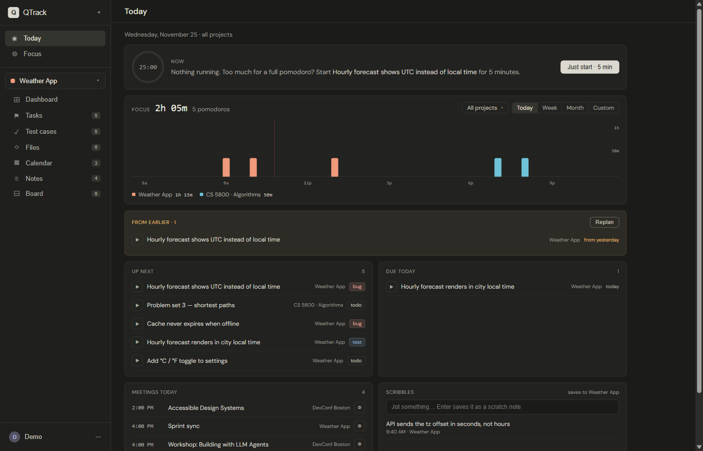
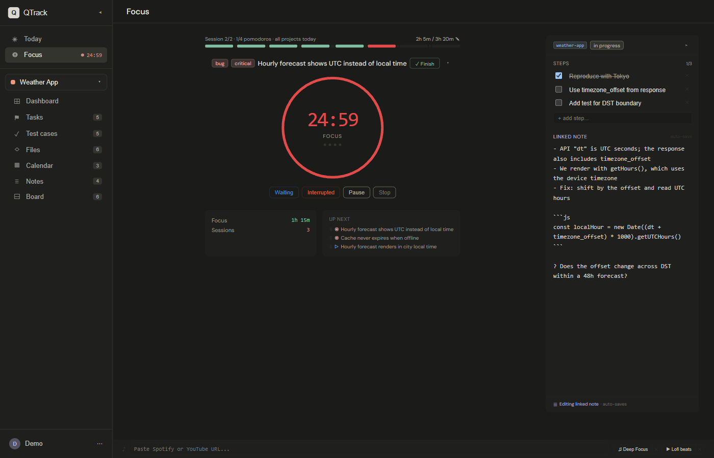
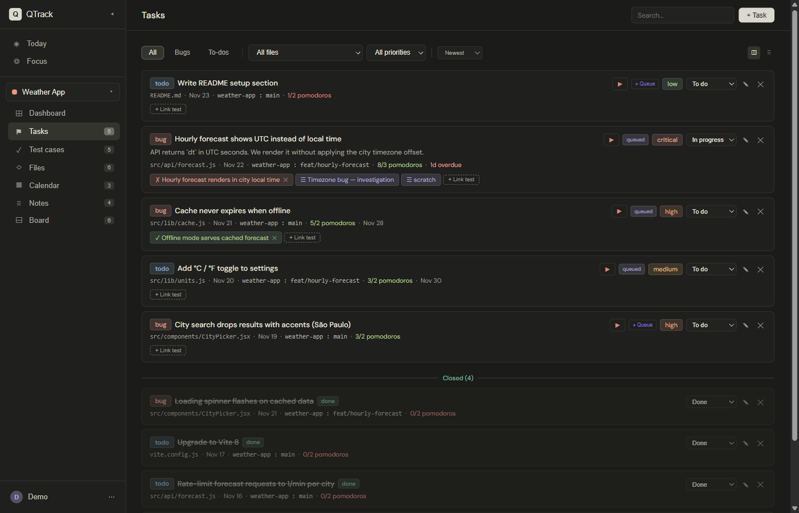
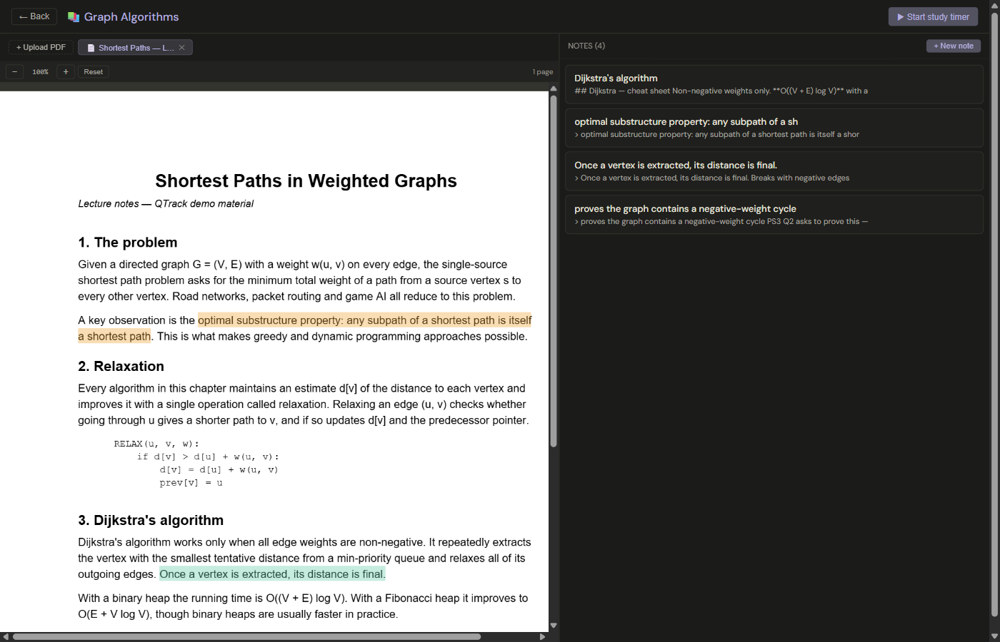
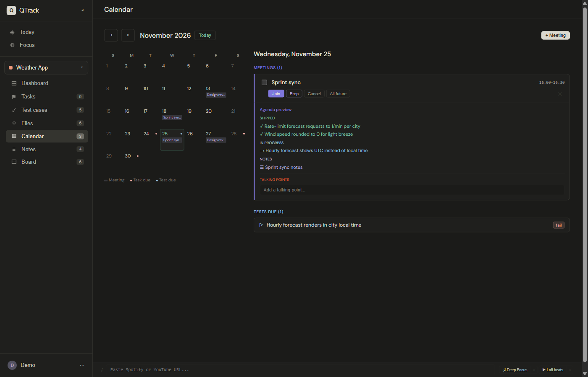
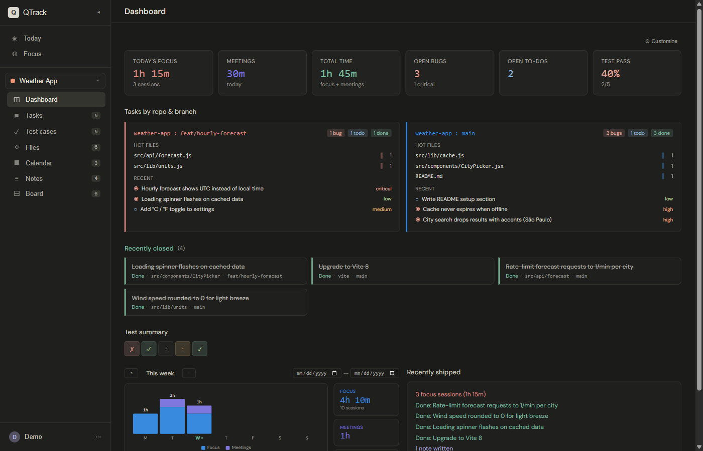
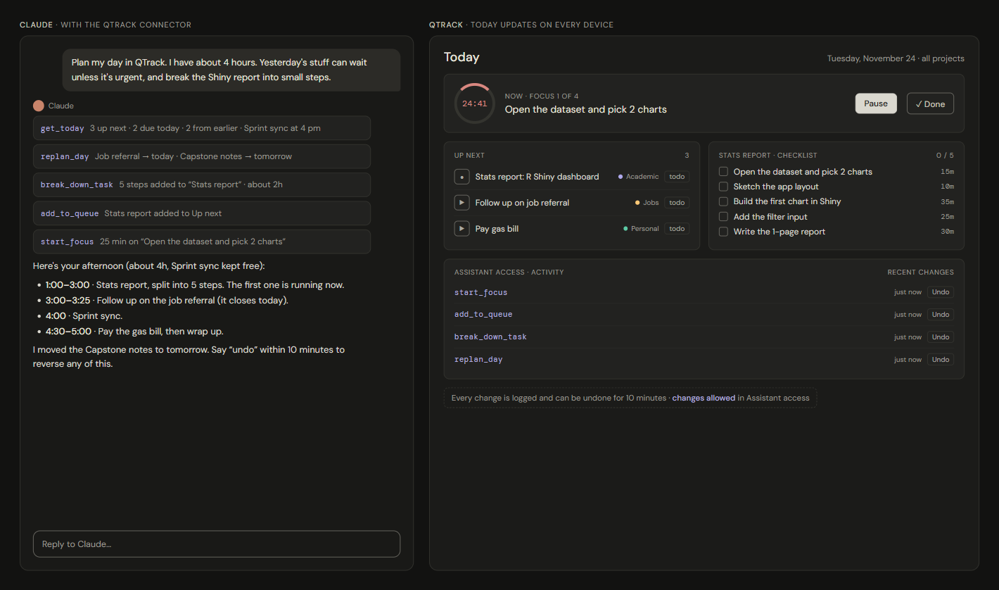

# QTrack

A calm focus workspace for developers, students, and anyone whose day doesn't go in a straight line. A Pomodoro timer, tasks, meetings, notes and study material live together, and your AI assistant can run it with you.

Today shows what's running, what's next, what slipped from yesterday, and how much you've focused, across every project. Start a full pomodoro, or just five minutes when starting is the hard part. When the day slips, replan it in one go without guilt. Ask Claude to add tasks, break one into steps, or start the timer, and every change it makes can be undone.

**[▶ Try the live demo](https://qtrack-steel.vercel.app/demo)** (no sign-up needed) · [Create an account](https://qtrack-steel.vercel.app/)



---

## Features

### ☀ Today
The default screen, across all your projects.

- **Now**: the running timer with Pause / Done. When nothing is running, **Just start · 5 min** gets you going on the next task. After 5 minutes it asks *Keep going?*: +20 makes a full pomodoro, Stop logs the 5 minutes
- **Focus chart**: minutes per hour today, or per day for a week, a month or a custom range. Bars are split by project color, and you can filter to a few projects. Your choice is remembered
- **From earlier**: tasks that slipped, labelled *from yesterday* / *from Thu*. **Replan** sends each to Today (and Up next), Tomorrow, Later, or lets it go, then offers Undo
- **Up next**, **Due today**, today's **meetings**, and quick **scribbles**
- Click any task to open its **details panel** (a bottom sheet on phones): change status, priority, due date and estimate, tick the checklist, see focus time and links, then Focus, Done, Skip or open it in its project

### ◎ Focus
A Pomodoro timer that knows what you're working on.



- 25 / 5 / 15 cycle with a long break after every 4, plus browser notifications and a chime
- Attach a session to a task, test case or study topic. Pomodoros count against the task's estimate
- **Daily goal** in pomodoros, saved to your account. Progress is today's focus time across all projects, so switching projects doesn't change it
- Pause with a reason (*waiting*, *interrupted*). That time is logged separately and doesn't count as focus
- **Context drawer** with the task's steps and a scratchpad that saves to its linked note
- The timer lives on the server, so it survives refreshes and syncs across devices
- Log past work manually, get break ideas (🏢 office / 🏠 home), and play music from YouTube or Spotify in the bottom dock

### ⚑ Tasks & test cases



- **Tasks** are bugs or to-dos with priority, due date, estimated pomodoros and repo/branch. Status is **To do · In progress · Done · Skipped**: letting a task go is a valid outcome
- **Test cases** have preconditions, inline-editable steps with expected results, and pass / fail / blocked
- Link tasks to test cases, filter and sort, switch between cards and a list, and queue anything with one click

### ★ Study mode



- Group material into **topics**, each with its notes and study time
- Read PDFs in the built-in reader. **Select text to highlight it and create a note**; click a highlight to jump back to the note
- Notes render **Markdown**, **Mermaid** diagrams and syntax-highlighted code
- Start a study timer from any topic

### ▦ Calendar & meetings



- Month calendar with meetings (including recurring ones) and due dates
- **Tag a task or note with a meeting** and it lands on that meeting's agenda, grouped into *shipped*, *in progress* and *notes*, counting only what changed since the last meeting you attended
- Join a meeting for a timer and an auto-saving notes pad. Track attendance, cancellations and talking points

### ⊞ Dashboard



- Today's focus and meeting time, open bugs and to-dos, test pass rate
- Open work grouped by **repo : branch**, with "hot" files, and recently closed items
- A weekly focus / meetings chart you can page through

### And also
- **Projects**: a switcher with search, recent projects and open-task counts (Ctrl/Cmd+K), a color per project, archive and restore, and delete with a confirmation that lists what will be lost
- **Themes**: Calm (default), Soft, High contrast, Light, Blush, Hero, Black & Gold, Red & Gold, or System to follow your device. Every theme passes WCAG contrast for labels and controls. Pick one from the account menu ([side-by-side preview](docs/proposals/color-palette/mock.png))
- **Phone layout** with a bottom tab bar and a More sheet
- **Notes** with categories, pinning, code blocks, and links to tasks, files, repos and meetings
- **Board**: a sticky-note Kanban per project; cards can become tasks
- **Workshop projects** for conferences: sessions, people you met, and an action-item / question / insight digest from your notes
- **News** *(premium)*: an AI-curated feed for topics you choose
- A **guided tour** on first visit, which you can replay from the account menu

---

## Use with Claude (MCP)

QTrack runs a remote [MCP](https://modelcontextprotocol.io) server, so Claude (or any MCP client) can read and change your QTrack with you. You sign in with your own account through OAuth; there are no API keys to copy.


<sub>Illustration with sample data.</sub>

**Connect** from **Assistant access** in the account menu, which shows the URL and the command. For Claude Code:

```bash
claude mcp add --transport http --scope user qtrack https://jsbazeewkiaisdsohtav.supabase.co/functions/v1/mcp
```

Then run `/mcp`, pick `qtrack`, and approve access. In Claude.ai or Claude Desktop, add the same URL as a custom connector.

**What it can do**

| Reads | Changes |
|---|---|
| `get_today`: up next, due, meetings, scribbles | `start_focus` / `pause_focus` / `resume_focus` / `stop_focus` |
| `search_tasks`: find a task by name | `add_task`, `add_to_queue`, `capture_note` |
| `get_focus_stats`: today or the last 7 days | `update_task`: status, priority, due date, title |
| `get_timer`: what's running right now | `break_down_task`: write small steps into the checklist |
| `list_projects` | `replan_day`: move leftovers to today / tomorrow / later / let go |
| | `log_focus`: record pomodoros done without the timer |
| | `archive_project` / `restore_project`, `delete_task`, `undo` |

**Safety**
- Changes are **off until you turn on** "Let assistants make changes" in Assistant access
- Every call is logged there, and any change can be **undone for 10 minutes**, from the app or by asking
- At most 60 changes an hour; destructive tools ask the assistant to confirm with you first
- You can see and revoke connected apps at any time

Tool details and server setup: [supabase/README.md](supabase/README.md).

---

## Tech stack

| Layer | Choice |
|---|---|
| UI | React 19 with inline styles and CSS-variable themes, DM Sans |
| Build | Vite 8 |
| Backend | Supabase: Postgres with Row Level Security, Auth (email, GitHub, Google, OAuth 2.1 server), Storage, Realtime, Edge Functions |
| MCP server | Supabase Edge Function (Deno) using `@modelcontextprotocol/server`, sharing query code with the web app |
| Tests | Vitest, running the MCP tools against the in-browser demo database |
| Loaded on demand | `pdfjs-dist` and `mermaid` from esm.sh, YouTube IFrame API |
| Hosting | Vercel |

---

## Getting started

### Try it without setup
Open **[/demo](https://qtrack-steel.vercel.app/demo)**. The demo runs the full app against sample data stored in your browser, with no account and no backend. Your changes stay on your device, and the data resets each day.

### Run it locally

**Prerequisites:** Node.js 20+ and a [Supabase](https://supabase.com) project.

```bash
git clone https://github.com/Subhash-269/qtrack.git
cd qtrack
npm install
```

Create `.env` in the project root:

```env
VITE_SUPABASE_URL=https://<your-project>.supabase.co
VITE_SUPABASE_ANON_KEY=<your-anon-key>
```

Then:

```bash
npm run dev       # http://localhost:5173  (demo mode: http://localhost:5173/demo)
npm test          # Vitest
npm run build     # production build → dist/
npm run preview   # serve the build locally
```

Demo mode doesn't need Supabase at all, so `/demo` works before you've set up `.env`.

### Supabase setup

The Supabase CLI is a dev dependency, so use it through `npx`:

```bash
npx supabase login
npx supabase link --project-ref <your-project-ref>
npx supabase db push --remote                          # apply supabase/migrations
npx supabase functions deploy mcp --no-verify-jwt      # the MCP server
```

> **Known gap:** the migrations only cover the newer tables (`mcp_calls`, `mcp_settings`, `user_settings`, project archive and color, timer and status changes). The original tables were created by hand, so a brand-new project also needs:
>
> ```
> projects          files            issues           test_cases
> issue_test_links  focus_sessions   timer_state      task_queue
> meetings          notes            study_docs       study_highlights
> board_columns     board_cards      workshop_people  news_cache
> user_profiles
> ```
>
> Each is scoped by `user_id` with RLS. The columns are in [`src/storage.js`](src/storage.js), and [`src/demo/seed.js`](src/demo/seed.js) shows the shape of each record. A full baseline migration is on the roadmap.

You'll also need:
- A Storage bucket named **`study-docs`** for PDFs
- Realtime enabled on `timer_state` for cross-device timer sync
- Email auth, plus GitHub/Google if you want them, with your dev and prod URLs in the allowed redirect URLs
- For the MCP server: the OAuth 2.1 server and dynamic client registration turned on in Auth settings, and `/oauth/consent` as the authorization path (see [supabase/README.md](supabase/README.md))
- *(Optional)* an Edge Function named **`news-feed`** for the News tab

---

## Project structure

```
src/
├── main.jsx                # Auth gate and OAuth consent routing; applies the theme
├── App.jsx                 # Shell and most views: Focus, Dashboard, Tasks, Notes, Study, Calendar, …
├── views/                  # TodayView, AssistantView
├── components/             # Sidebar, TaskDetailsPanel, FocusChart, ReplanDialog, project colors
├── theme.js                # Theme tokens (CSS variables) and the theme picker's data
├── storage.js              # Data layer: Supabase queries grouped by domain
├── OAuthConsent.jsx        # "Allow access" page for assistants
├── supabaseClient.js       # Real Supabase client, or the demo client on /demo
└── demo/                   # In-browser Supabase stand-in and sample data
supabase/
├── migrations/             # SQL migrations
└── functions/
    ├── _shared/            # Queries, actions and statuses shared by the app and the MCP server
    └── mcp/                # The MCP Edge Function and its tools
tests/                      # Vitest: MCP tools, statuses, focus chart, project archive
docs/
├── screenshots/            # Images used in this README
└── proposals/              # Design proposals and mockups (MCP, Today, themes, competitor notes)
```

---

## Roadmap

- **Mobile apps** for the Play Store and App Store (Capacitor), with native timer notifications
- **Sign in with Apple** and **delete account** in the app (store requirements)
- A **baseline migration** so a new Supabase project can be set up from migrations alone
- Calmer wording across the app, and a multitasking-friendly focus mode
